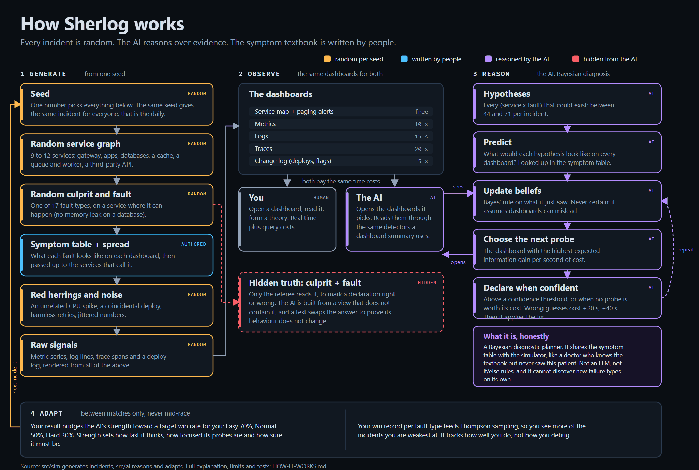

# How Sherlog works, and whether the AI is real

A lot of tools sold as "AIOps" are scripts: *if the health check fails, restart the pod*. That is useful automation, but someone wrote the decision in advance. This page says exactly what Sherlog's opponent does, what is human-written, and where the limits are. Every claim here maps to code or a test.

## The short version

- **It is classical AI**: a Bayesian diagnostic planner. It is not an LLM, not a neural network and not a rulebook.
- **People wrote the symptom table** ("a memory leak looks like this on each dashboard"). The AI shares that table with the simulator, the way a doctor knows the textbook but has never seen *this* patient.
- **The AI does the reasoning**: it weighs conflicting evidence, decides which dashboard to open next, and decides when it is sure enough to commit. No code in `src/ai/` maps a symptom to a cause.
- **It cannot discover new failure types** from raw data. That is the honest ceiling.
- **Everything else is random**: the service graph, the culprit, the noise and the red herrings change with every seed.

## Hardcoded script vs Sherlog's AI

| | Hardcoded "AIOps" script | Sherlog's AI |
|---|---|---|
| Who decides the diagnosis? | A human, ahead of time (`if X then Y`) | The algorithm, at runtime, from evidence |
| A symptom combination nobody wrote a rule for | Falls through | Every hypothesis is scored against the evidence |
| Misleading signals | Fires on the first match | Weighs all evidence; can be fooled, then recovers |
| What to look at next | A fixed checklist | The probe with the most expected information per second |
| Does it know how sure it is? | No | A probability for every hypothesis |
| A new failure type | New rules, new code paths | Describe its symptoms in one data entry; no AI code changes |

## How an incident is generated

Everything below comes from one seed, through a seeded PRNG (`mulberry32`), so the same seed always gives the same incident.

- **Random:** the service graph (9 to 12 services), the culprit and fault type (17 types, only on services where they can happen), metric baselines and noise, log lines, trace timings, deploy and config-change times, and which red herrings appear (1, 2 or 3 depending on mode).
- **Written by people:** the symptom table per fault, in [`src/sim/faults.ts`](src/sim/faults.ts), and how symptoms spread up the call graph.
- **The daily** uses the date as its seed, so everyone gets the same incident. Anyone can compute the answer from the source, like Wordle's word list. Sherlog is practice, not a competition.

## How the AI reasons

1. **Hypotheses.** Every (service, fault) pair that could physically exist: between 44 and 71 per incident.
2. **Predict.** For each one, look up what it would look like on every dashboard.
3. **Update.** Naive Bayes: each observed symptom reweights every hypothesis. It assumes dashboards can mislead (a fixed 10% miss rate and 15% false-alarm rate), so no single signal is proof.
4. **Choose the next probe.** For each unopened dashboard, compute the expected drop in uncertainty (information gain) and divide by its time cost. Sample from a softmax over those scores; its temperature is a difficulty knob.
5. **Declare** once the top hypothesis passes a confidence threshold, or sooner when no remaining dashboard is worth its time cost (a bad deploy and a bad flag, for example, can't always be told apart with certainty). A wrong declaration costs +20 s, then +40 s, +60 s: the same rule you play by.
6. **Fix.** After the diagnosis it applies the mitigation, from the same fix table you choose from.

One strength dial sets how fast it thinks, how sloppy its probe choice is, how often it picks an unfocused probe and how sure it must be. Above 1.0 only its speed keeps rising. The reasoning is greedy one-step information gain on a naive-Bayes model, which is good but not optimal.

## A real investigation

This is the actual output of the shipped AI at Normal strength on seed 446: a retry storm in `pricing`, with routine retries and harmless timeouts in `shipping` as red herrings. The postmortem screen shows this same trace after every match, plus a chart of how sure the AI was of the right answer at each step.

| Step | What the AI did | Its top suspects afterwards |
|---|---|---|
| Start | Reads the 4 paging alerts | Retry storm @ cart, shipping, pricing: 13% each |
| 1 | Opens `logs:cart` | shipping 35%, pricing 35% |
| 2 | Opens `logs:edge-gateway` | shipping 42%, pricing 42% |
| 3 | Opens `logs:shipping` | Retry storm @ shipping **84%** (it found retries: the red herring) |
| 4 | Declares shipping | **Wrong, +20 s.** Now pricing 88% |
| 5 | Declares pricing | Correct |
| 6 | Applies the fix: revert the retries and add backoff | MTTR 3:14 |

It was fooled by the red herring, paid for it, recovered and fixed the problem. A script that matches "retries in the logs" would have stopped at step 3.

To reproduce: `simulateAi(generateIncident({ seed: 446, mode: 'normal' }), 0.4)`. Seeds belong to a version of the generator: adding fault types changes what a seed produces, so a trace like this is tied to the code it was recorded on.

## Can the AI cheat?

It cannot read the hidden answer. The AI is constructed from a `PlayerView` (the service map, the paging alerts, and a function that opens a dashboard), not from the incident object. A test (`tests/ai.test.ts`, "what the AI is allowed to know") swaps the hidden answer and wipes the simulator's own bookkeeping, and the AI behaves identically until a declaration is judged.

## What is not what it looks like

Being straight about this is the point of the page:

- **The race is a replay.** The AI's whole run is computed when the match starts and replayed against the clock. It does not react to your moves. That is what makes the daily identical for everyone and the postmortem possible. It is a ghost race, not a live opponent.
- **Difficulty is mostly speed and focus.** At the default strengths the AI almost never guesses wrong. A "weak" AI is slow and unfocused, not mistaken. Modes also differ in system size (Easy is smaller, Hard is bigger), in red herrings (1, 2, 3) and in Hard mode losing one signal on the culprit; none of that slows the AI much.
- **The AI knows the fix table too.** After diagnosing it always picks the right mitigation, because it shares that table. Only you pay for wrong fixes.
- **The AI shares the simulator's symptom table.** A skeptic can fairly call it "Bayesian inference over the generator's own table". That is accurate. The reasoning (evidence weighting, probe choice, stopping rule) is the AI's; the knowledge it reasons over is the textbook.
- **"Adding a fault needs no AI code"** is tested (`tests/unseen-fault.test.ts`), but the test hands the AI the new fault's symptoms. It shows the reasoning generalises to a new table, not that the AI discovers failure types.
- **It adapts to how well you do, not how you debug.** After each match it moves one strength number toward your mode's target win rate (Easy 70%, Normal 50%, Hard 30%) and tracks a win record per fault type to pick your next incident (Thompson sampling). It does not model your habits, such as which dashboard you open first.
- **The balance is tuned on simulated players.** Convergence to the target win rates is tested against simulated players, not real people yet.
- **The incidents are a stylised teaching sim** with 17 fault types and binary symptoms, not real production data.
- **There is no LLM.** That is a design choice: for a diagnosis problem with a known set of causes, probabilistic reasoning is cheaper, faster and explainable. It costs nothing to run.

## Guessing does not pay

A player who never opens a dashboard and just guesses used to beat the Normal AI 44% of the time. Each wrong guess now costs 20 s more than the last, and with 44 to 71 candidates a blind guesser beats it about 8% of the time, while skilled play is almost untouched (`tests/ai.test.ts`, "guessing does not pay"). Picking the wrong fix is penalised the same way.

## A litmus test for "AIOps" claims

1. Does it reason under uncertainty, saying "70% this, 25% that", or just match a pattern?
2. What happens with a combination of symptoms nobody wrote a rule for?
3. Does it choose what to investigate, or run a fixed checklist?
4. Does it survive a red herring, or fire on the first coincidence?
5. Does it learn from outcomes, or behave identically forever?
6. Can it explain its conclusion with the evidence that changed its mind?

A script that restarts a process when a health check fails answers no to all six. That is fine: it is automation. Just don't call it AI.
