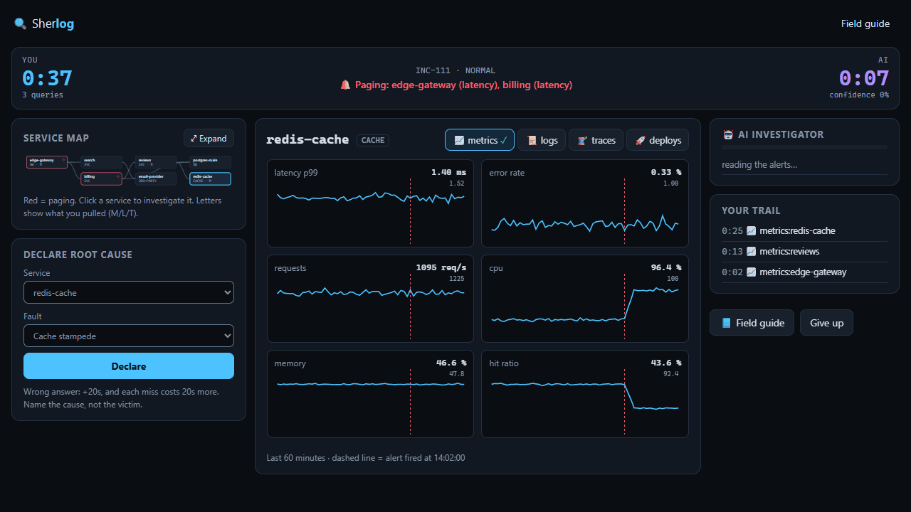
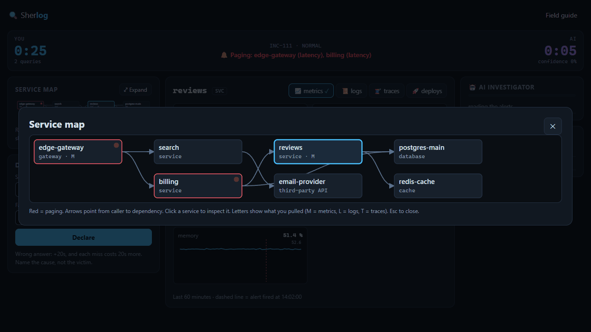
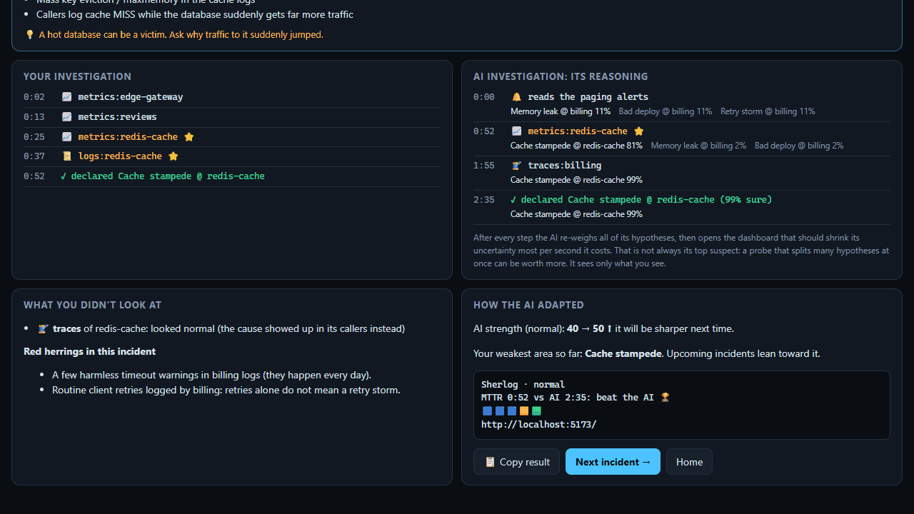

<div align="center">

# 🔍 Sherlog

**An on-call detective game. Production is on fire: race an AI to the root cause.**

### [▶ Play now at sherlog-five.vercel.app](https://sherlog-five.vercel.app/)

free · runs entirely in your browser · no account · no API keys · no LLM

[](https://github.com/maheedhar132/Sherlog/actions/workflows/ci.yml)
[](LICENSE)
[](CONTRIBUTING.md)


</div>

You get paged: latency is burning the SLO. You and an AI investigator see **the same dashboards**: a service map, metrics, logs, traces and a deploy log. Every query costs time. The first to name the **root cause** (the service *and* the fault) wins. Then a postmortem replays your path next to the AI's reasoning.

| | | |
|:---:|:---:|:---:|
|  |  |  |
| Investigate | Read the topology | Compare with the AI |

Incidents are generated from a seed (random service graph, culprit, noise and red herrings), so there is always a new one, plus a **daily** that is the same for everyone.

## Is the AI real?

The opponent is a Bayesian diagnostic planner. It holds a probability for every (service, fault) hypothesis, picks which dashboard to open by expected information per second, and decides when it is sure enough to commit. It is not an LLM and not if/else rules.

It is also honest about its limits: it shares the simulator's symptom table (written by people), it replays a precomputed run rather than reacting live, and it adapts to how well you do, not to how you debug. It cannot read the hidden answer, and a test checks that.

[](HOW-IT-WORKS.md)

**[HOW-IT-WORKS.md](HOW-IT-WORKS.md)** has a real investigation trace (the AI gets fooled by a red herring, then recovers), the full list of limits and a litmus test for "AIOps" claims.

## Modes

| Mode | Target | Notes |
|---|---|---|
| Easy | you win ~70% | 1 red herring |
| Normal | you win ~50% | 2 red herrings, coincidental deploys |
| Hard | you win ~30% | 3 red herrings |
| Daily | fixed AI | same incident and AI for everyone, with a streak |

Metrics cost 10 s, logs 15 s, traces 20 s, deploys 5 s. A wrong answer costs 20 s, then 40 s, then 60 s, so guessing does not pay. After each match the AI's strength moves toward your target win rate, and you see more of the incident types you are weakest at. The targets are tuned on simulated players so far, so real-player feedback is welcome.

## Your profile and daily streaks

Sherlog has no accounts and no server, so your profile lives in **your browser** (`localStorage`): the AI's calibration, your record per fault type, your recent matches and your daily streak.

**Streaks work like Wordle.** Play the daily every day in the **same browser on the same device** and Sherlog tracks your current streak, your best streak and your daily stats. A day counts when you **solve** the daily (name the root cause), even if the AI beats you. Giving up, or skipping a day, resets it. Days roll over at your local midnight.

A different browser, device or private window starts from scratch, and clearing site data erases your profile. **Export profile** and **Import** on the home screen move it between browsers. Nothing is uploaded or verified, so streaks are for you, not for a leaderboard.

## Run it

```bash
git clone https://github.com/maheedhar132/Sherlog.git
cd Sherlog
npm install
npm run dev
```

`npm test` runs the simulation, AI and streak tests. To host your own copy: [](https://vercel.com/new/clone?repository-url=https%3A%2F%2Fgithub.com%2Fmaheedhar132%2FSherlog)

## Contributing

PRs are welcome: fork, branch, open a PR. `main` is protected, CI must pass and every PR is reviewed, with a Vercel preview so reviewers can play your change. Read **[CONTRIBUTING.md](CONTRIBUTING.md)** first.

The best contribution is a **new fault type**: one entry in [`src/sim/faults.ts`](src/sim/faults.ts) (where it can happen, its symptoms, a postmortem story). Ideas: certificate expiry, disk full, clock skew, thread-pool exhaustion, a bad feature flag, Kafka consumer lag.

## Roadmap

- [ ] Debugging-style insights: which dashboards you open first, and when you declare too early
- [ ] More fault types and multi-fault incidents
- [ ] Installable PWA that works offline
- [ ] An optional local-LLM coach for the postmortem (off by default; the game stays LLM-free)

## Related projects

Other incident-training games worth a look: [SRE Simulator](https://github.com/tuxerrante/SRESimulator), [YouBrokeProd (write-up)](https://dev.to/cdnsteve/how-i-turned-my-worst-on-call-nightmare-into-a-browser-game-36fa), [ON-CALL](https://github.com/kanishk-sachdeva/oncall-simulator), [SysAdmin Simulator](https://sys-admin-simulator.com/practice/incident-response) and [RootCause](https://root-cause.app/). Sherlog's angle is a generated, endless incident with a reasoning AI you can race and then inspect.

## License

MIT. See [CHANGELOG.md](CHANGELOG.md) for releases.
