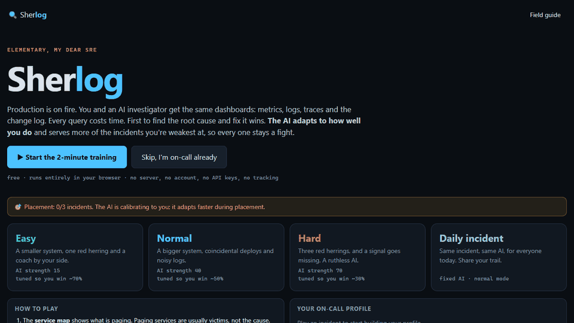

<div align="center">

# 🔍 Sherlog

**Production is on fire. Race an AI on-call engineer to the root cause. It learns how you debug.**

<!-- After the first Vercel deploy, replace this line with: [▶ Play in your browser](https://<your-project>.vercel.app) -->
free · offline · no account · no API keys

[](https://vercel.com/new/clone?repository-url=https%3A%2F%2Fgithub.com%2Fmaheedhar132%2FSherlog)

<!-- Record a 15s GIF of one match and drop it here: it's the single biggest driver of stars. -->
<!--  -->

</div>

---

You get paged. `edge-gateway` latency is burning its SLO. You and an AI investigator see **the same dashboards**: a service map, metrics, logs, traces and a deploy log. Every query costs investigation time. The first to name the **root cause** (the service *and* the fault) wins.

Then the postmortem replays your investigation next to the AI's, so you see exactly where it reasoned better and which signal you skipped.

## Why it's different

- **It trains a real skill.** The incidents follow real failure patterns: memory leaks, saturated databases, bad deploys, cache stampedes, retry storms, DNS failures. Red herrings included, like coincidental deploys, noisy logs and an unrelated CPU spike.
- **The AI doesn't cheat.** It reads the same signals you do, through the same query API, and pays the same time costs. It never sees the hidden answer.
- **It adapts to you, between matches only.** No rubber-banding mid-race. After each match the game:
  1. nudges the AI's strength toward your mode's target win rate (Easy ~70%, Normal ~50%, Hard ~30% for you), and
  2. uses **Thompson sampling** over your per-fault-type record to serve more of the incidents you're weakest at.
- **$0, forever.** No LLM, no server, no download. The "AI" is a few hundred lines of Bayesian inference that runs in your tab in milliseconds.

## How the AI works

The investigator holds a probability for every `(service, fault)` hypothesis the topology allows.

1. **Prior from the alerts**: which customer-facing services are paging.
2. **Choose a query**: for each untried query, compute the *expected information gain* (entropy reduction) divided by the query's time cost. Then sample from a softmax over those scores. Its temperature is one of the difficulty knobs.
3. **Observe and update**: read the signals with the same detectors that summarise a dashboard, then run a naive-Bayes update with explicit miss and false-alarm rates (red herrings are why the false-alarm rate isn't zero).
4. **Declare** once the top hypothesis passes a confidence threshold. A wrong guess costs it +20s, just like you.

One `strength` dial drives temperature, confidence threshold, thinking speed and the chance of an unfocused query. Above 1.0 its reasoning is already optimal and only its speed keeps rising, so experts still get a fight.

Simulation and inference share one source of truth (`src/sim/faults.ts`). The AI knows the textbook, and so can you: open the in-game **Field guide**.

> **Is it really AI, or just hardcoded rules?** There isn't a single `if symptom then cause` rule in the AI code, and a test proves it diagnoses a fault type it was never written for. The full explanation, a real step-by-step investigation and the honest limits are in **[HOW-IT-WORKS.md](HOW-IT-WORKS.md)**.

## Modes

| Mode | Red herrings | AI target | Starts at |
|---|---|---|---|
| Easy | 1 | you win ~70% | strength 15 |
| Normal | 2 (incl. coincidental deploys) | you win ~50% | strength 40 |
| Hard | 3 (incl. unrelated latency blips) | you win ~30% | strength 70 |
| Daily | Normal | fixed AI, same incident for everyone | strength 50 |

Your first 3 incidents are **placement**: the AI adapts faster while it calibrates to you.

## Run it locally

```bash
git clone https://github.com/maheedhar132/Sherlog.git
cd Sherlog
npm install
npm run dev
```

`npm test` runs the simulation and AI test suite. It checks determinism, that detection reads back exactly what was rendered, that the AI always converges on the true cause, and that adaptation hits each mode's target win rate.

## Deploy your own

Sherlog is a static site with no backend, so it hosts free anywhere. It's set up for **Vercel**:

1. Click **Deploy with Vercel** above, or import the repo at [vercel.com/new](https://vercel.com/new).
2. Keep the detected settings. [`vercel.json`](vercel.json) already sets Vite, `npm run build` and the `dist` output.
3. Every push to `main` redeploys automatically, and every pull request gets a preview URL.

GitHub Actions ([`ci.yml`](.github/workflows/ci.yml)) runs the tests and build on every push and pull request.

## Project layout

```
src/sim/      seeded topology, fault definitions, signal rendering, detection
src/ai/       Bayesian investigator, adaptive difficulty, Thompson-sampling scenario picker
src/game/     match setup, daily seed, share card
src/ui/       React UI (service map, panels, postmortem)
tests/        vitest suite
```

## Contributing

The best contributions are **new fault types**. Each one is a single entry in `src/sim/faults.ts`: which services it can hit, its symptoms per channel, and the story and tips for the postmortem. The test suite automatically checks that your fault renders, gets detected and gets solved. Ideas: certificate expiry, disk full, clock skew, noisy neighbour, thread-pool exhaustion, a bad feature flag, a Kafka consumer lag spiral.

## Roadmap

- [ ] Optional local LLM coach for the postmortem (WebLLM / Ollama, only if you have it)
- [ ] Community scenario packs (JSON)
- [ ] Guided tutorial campaign
- [ ] More fault types and multi-fault incidents

## License

MIT
